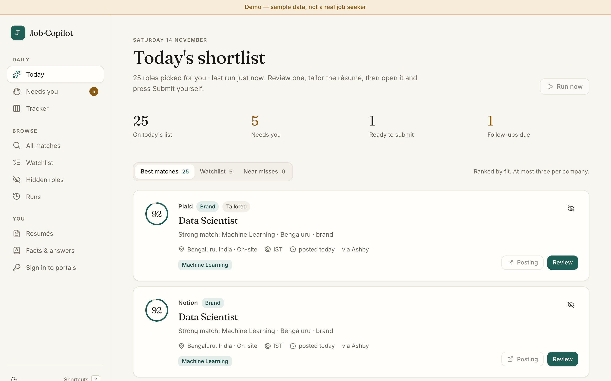
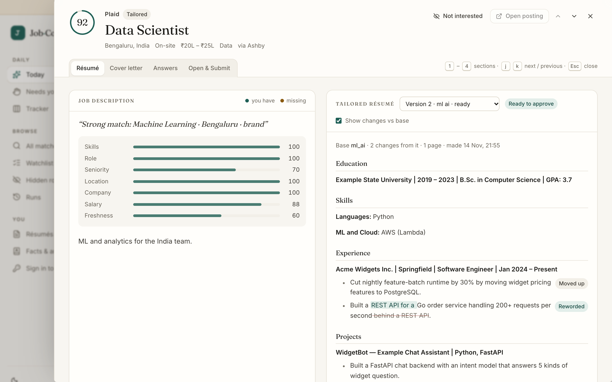
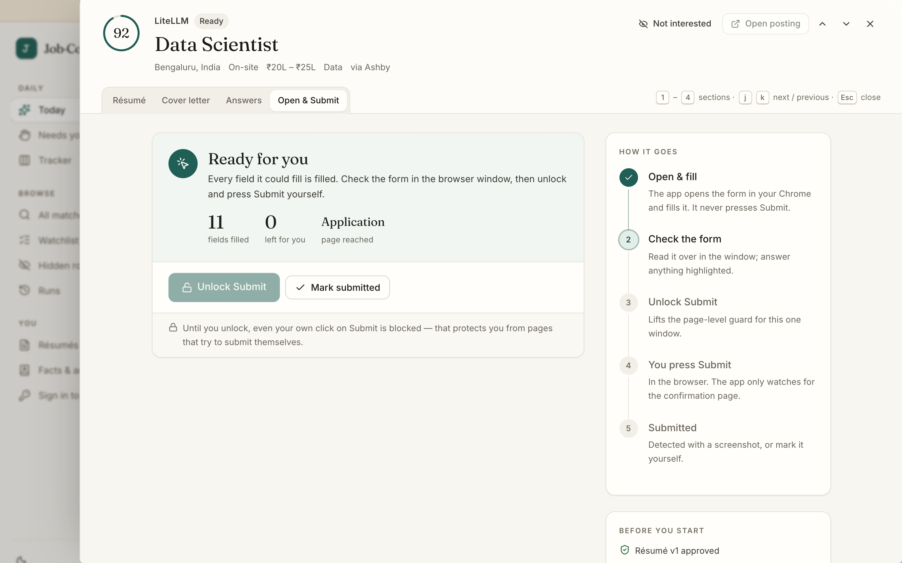
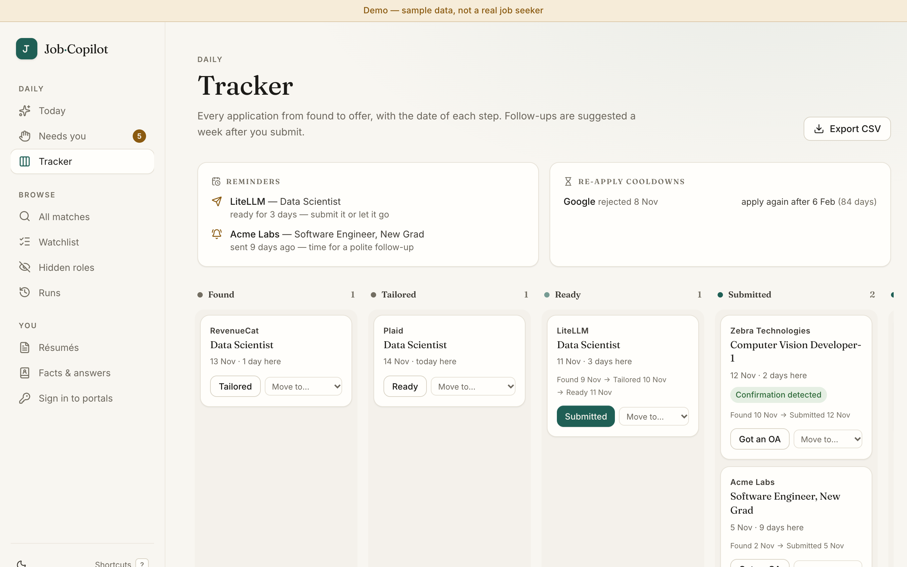

# Job-Copilot

Job-Copilot is a local, human-in-the-loop assistant for job applications. Each
night it collects postings from employers' own applicant-tracking systems and
from job boards that allow it, filters them with explained rules, and ranks
them. For the best matches it drafts a tailored résumé built only from facts
you have confirmed, and prepares a plan for filling in the application form.
In the morning you review each draft, open the form, watch it fill in, finish
what it couldn't, and press **Submit** yourself. Nothing is ever submitted,
sent or invented for you.

> Design rationale and trade-offs: [`docs/DESIGN.md`](docs/DESIGN.md).

## Key features

- **Wide, polite sourcing.** Public board APIs of Greenhouse, Lever, Ashby,
  Workday and other ATSs such as Workable, Recruitee, Rippling and Teamtailor;
  remote job boards and RSS feeds; community
  lists such as Hacker News "Who is hiring" and new-grad lists. All requests go
  through one HTTP client with robots.txt, an honest user agent and rate limits.
- **Employer discovery.** Seed datasets of companies and their ATS boards,
  automatic ATS detection from careers pages, and a rotating probe that
  verifies a bounded slice of boards per run.
- **Explained filtering.** Role, experience, seniority, geography, salary and
  company-tier rules. Every exclusion is stored with its reason and a quoted
  excerpt, and you can browse them.
- **Transparent fit score.** A deterministic score built from weighted
  components (skills, role, seniority, location, company, salary, freshness,
  semantic similarity), with the matched and missing skills shown.
- **Daily queue** with three lanes: main, extended (unverified or watchlist
  employers) and near-miss, so a good role caught by a strict rule can still be
  rescued.
- **Fact-grounded tailoring.** The LLM returns an edit plan over fact ids, not
  prose. Every output line cites its facts and is checked against them, then
  rendered to a one-page pdfLaTeX résumé with a diff against your base.
- **Grounded cover letters and emails**, checked sentence by sentence, with a
  cliché filter and a length limit.
- **Answers bank and matcher.** Screening questions are matched to your
  approved answers. Anything negated, ambiguous, consent-related or uncertain
  is left for you.
- **Autofill that stops before Submit.** Headed Chrome on your own profile
  fills the approved values, highlights what it couldn't fill, pauses on
  CAPTCHAs and login walls, and hands the browser back to you.
- **Tracker** from found to offer, with follow-up reminders and re-apply
  cooldowns.
- **Nightly run** via a macOS LaunchAgent, with per-step health and a "Run
  now" button.

## Safety guarantees

- **It never submits an application.** The browser layer has no submit method;
  while filling, a guard blocks submit clicks, scripted form submissions and
  every non-GET request. Submit works only after you explicitly take over, and
  then only your own click submits.
- **It never automates LinkedIn, Indeed, Naukri, Glassdoor, Wellfound or YC's
  sites.** They are on a do-not-automate list enforced in the HTTP client and
  the browser. Jobs from them are link-out only, and YC companies are applied
  to through their own ATS.
- **It never bypasses CAPTCHAs or bot checks.** A challenge pauses the fill for
  you. Challenge frames are never touched, and no stealth or anti-detection
  browser flags are used.
- **It respects robots.txt and rate limits**, reading robots.txt before the
  first request to a host and preferring official APIs and feeds. The verdict
  for every source is in [`docs/SOURCES.md`](docs/SOURCES.md).
- **It never fabricates résumé content.** Tailoring can only select, reorder
  and rephrase confirmed facts; employers, titles, dates and numbers are locked;
  anything unsupported goes to review instead of into the PDF.
- **Your personal data stays local.** The profile, database, generated
  documents and browser profile are git-ignored or live outside the repo. A
  PII check runs in CI. No passwords or ID numbers are stored, and portal
  logins are done by hand.

## How it works

```mermaid
flowchart LR
    S["Sources<br/>ATS APIs, boards, feeds, lists"] --> D["Discovery<br/>seeds, ATS detection, probe"]
    D --> F["Filter + score<br/>reasons kept, fit + why"]
    F --> Q["Daily queue<br/>main, extended, near-miss"]
    Q --> T["Tailor<br/>fact-id edit plan, grounded"]
    T --> P["Fill plan<br/>read-only, values from approved answers"]
    P --> R{{"Human review<br/>approve résumé + answers"}}
    R --> A["Autofill<br/>stops before Submit"]
    A --> H{{"Human submits"}}
    H --> K["Tracker<br/>follow-ups, outcomes"]
```



## Screenshots

<table>
  <tr>
    <td><a href="docs/screenshots/today-light.png"></a><br><sub><b>Today</b>: the ranked daily queue with the reasons for each fit</sub></td>
    <td><a href="docs/screenshots/review-light.png"></a><br><sub><b>Review</b>: JD next to the tailored résumé diff, with grounding flags</sub></td>
  </tr>
  <tr>
    <td><a href="docs/screenshots/open-submit-light.png"></a><br><sub><b>Open &amp; Submit</b>: live fill status and the hand-over</sub></td>
    <td><a href="docs/screenshots/tracker-light.png"></a><br><sub><b>Tracker</b>: every application from found to outcome</sub></td>
  </tr>
</table>

Dark theme: [Today](docs/screenshots/today-dark.png) ·
[Review](docs/screenshots/review-dark.png) ·
[Open & Submit](docs/screenshots/open-submit-dark.png) ·
[Tracker](docs/screenshots/tracker-dark.png)

## Quick start

Requirements: macOS (the scheduler uses launchd), Python 3.13, Node (only to
build the UI), Google Chrome (for autofill) and
[TinyTeX](https://yihui.org/tinytex/) or another pdfLaTeX (for résumé PDFs).

```sh
make setup                     # venv + all Python deps; creates .env from .env.example

cp -r profile.example profile  # then replace every value with your own
make facts-check               # validate profile/resume_facts.yaml
make facts-review              # list the facts you still need to confirm

make ui                        # build the React UI into server/static/dist
make dev                       # app with auto-reload on http://127.0.0.1:8000
# or: make run                 # the same without reload

make daily                     # run the nightly pipeline now
make daily-fixtures            # the same on test fixtures, no network
make schedule-install          # install the nightly LaunchAgent
```

- The LLM provider is set in `.env` (`LLM_PROVIDER`): local Ollama only, or a
  hosted provider with Ollama as the fallback. Check it with `make llm-check`.
- Filters, scoring weights, the schedule and autofill behaviour are configured
  in `config/*.yaml`; each file documents its own knobs.
- `make help` lists every target.

## Project layout

```
config/            filters, scoring, sources + HTTP politeness, schedule, autofill, writing, LaTeX
jobcopilot/
  http.py          PoliteClient: robots.txt, honest UA, per-host + per-platform rate limits, denylist
  connectors/      one module per ATS / board: fetch_raw() + pure parse()
  discovery/       seed datasets, YC list, startup map, ATS detection, rotating probe
  ingest.py        sources -> jobs, with cross-source dedupe (dedupe.py)
  eligibility.py   hard rules -> lane + reasons with quoted excerpts
  fit.py           deterministic fit score with per-component "why"
  queue.py         daily queue (main / extended / near-miss), tracker, excluded view
  tailor_v2.py     edit-plan tailoring; grounding.py checks every line
  resume/          LaTeX rendering, one-page guard, ATS round trip
  writing/         cover letters, application and follow-up emails
  answers.py       answers bank + question matcher with safety guards
  autofill/        fill plans, SafePage, submit guard, adapters, detectors
  daily.py         the nightly pipeline
  llm.py           provider fallback chain (hosted -> local Ollama)
server/            FastAPI app (local-API hardening in app.py) and routers
web/               React + TypeScript + Tailwind UI (built by `make ui`)
profile.example/   a fake profile; copy it to the git-ignored profile/
scripts/           PII check, LaunchAgent installer, demo deploy
tests/             offline test suite with recorded fixtures
docs/              design, sources, learnings, writing guide, deploy
```

## Testing

```sh
make test     # offline test suite (no network, fixtures only)
make pii      # fail if personal data is in tracked files
make check    # both, as CI runs them
```

CI also validates the example profile's schema and builds the Docker image.
Autofill is tested against locally served fixture forms, including pages that
try to submit themselves, redirect to a denied host or show a CAPTCHA.

## Demo

A public demo runs on Google Cloud Run with fixture data and a fake person
only: no network, no LLM, and no access to anything personal. Tailoring,
uploads and pipeline actions are disabled there. Run it locally with
`make demo-local`. Deployment steps, the cost model and the three layers that
keep personal files out of the image are in [`docs/DEPLOY.md`](docs/DEPLOY.md).

## Sources and attributions

Every source, its access verdict and the reasoning behind it are in
[`docs/SOURCES.md`](docs/SOURCES.md). Job cards always link back to the source
they came from.

Job boards and feeds used with attribution: [Himalayas](https://himalayas.app),
[Working Nomads](https://www.workingnomads.com), [Jobspresso](https://jobspresso.co),
[Remote OK](https://remoteok.com), [We Work Remotely](https://weworkremotely.com),
[Jobicy](https://jobicy.com), [Real Work From Anywhere](https://www.realworkfromanywhere.com),
[4 Day Week](https://4dayweek.io), [CryptoJobsList](https://cryptojobslist.com),
[Hasjob](https://hasjob.co), [Remote](https://apply.remote.com),
[Arbeitnow](https://www.arbeitnow.com), [NoDesk](https://nodesk.co) and
[Hacker News "Who is hiring"](https://news.ycombinator.com/submitted?id=whoishiring).

Community datasets, with thanks to their maintainers:

- [yc-oss/api](https://github.com/yc-oss/api): YC company names, websites and
  batches (used for discovery only, never for jobs)
- [Bangalore Startup Map](https://bangalorestartupmap.com): startups with
  stage, sector and website
- [kalil0321/ats-scrapers](https://github.com/kalil0321/ats-scrapers) (MIT):
  companies per ATS
- [colophon-group/jobseek](https://github.com/colophon-group/jobseek) (MIT):
  employer job boards
- [zshah101's internships list](https://github.com/zshah101/Automated-List-Of-Summer-2027-and-Fall-2026-Tech-Internships)
  (MIT): companies and their ATS
- [SimplifyJobs/New-Grad-Positions](https://github.com/SimplifyJobs/New-Grad-Positions)
  and [speedyapply](https://github.com/speedyapply/2027-SWE-College-Jobs):
  new-grad listings (no licence, so facts only: employer, board and link)

Ideas borrowed from other open-source job tools, and what was deliberately not
borrowed, are in [`docs/LEARNINGS.md`](docs/LEARNINGS.md).

## Licence

[MIT](LICENSE).
