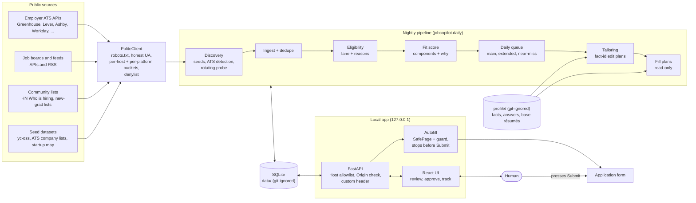

# Design

This document explains how Job-Copilot works and why it is built the way it
is. It describes ideas and trade-offs, not settings: every tunable value lives
in `config/*.yaml` (or in the git-ignored `profile/`), and this page names the
knob instead of quoting it.

Related reading: [`SOURCES.md`](SOURCES.md) (what each job source allows and
why), [`LEARNINGS.md`](LEARNINGS.md) (what was taken from other open-source
projects), [`WRITING_GUIDE.md`](WRITING_GUIDE.md) (rules for generated text),
[`DEPLOY.md`](DEPLOY.md) (the public demo).

## Contents

1. [Goal and stance](#1-goal-and-stance)
2. [Architecture](#2-architecture)
3. [The honest HTTP client](#3-the-honest-http-client)
4. [Discovery: finding employers and their boards](#4-discovery-finding-employers-and-their-boards)
5. [Ingest and cross-source dedupe](#5-ingest-and-cross-source-dedupe)
6. [Eligibility: nothing is dropped silently](#6-eligibility-nothing-is-dropped-silently)
7. [Fit scoring](#7-fit-scoring)
8. [The daily queue](#8-the-daily-queue)
9. [Tailoring by edit plan](#9-tailoring-by-edit-plan)
10. [Cover letters and emails](#10-cover-letters-and-emails)
11. [The answers matcher](#11-the-answers-matcher)
12. [Fill plans and the autofill safety model](#12-fill-plans-and-the-autofill-safety-model)
13. [The local API](#13-the-local-api)
14. [The nightly run](#14-the-nightly-run)
15. [Privacy, the LLM and the public demo](#15-privacy-the-llm-and-the-public-demo)
16. [Frontend](#16-frontend)
17. [Non-negotiables and where each is enforced](#17-non-negotiables-and-where-each-is-enforced)

---

## 1. Goal and stance

Applying for jobs has two expensive parts: finding the few postings worth
applying to, and producing a careful application for each. Job-Copilot
automates the preparation and leaves every judgement and every irreversible
action to the person:

- the machine finds, filters, ranks, drafts and pre-fills;
- the human confirms facts, approves drafts, answers what the machine is unsure
  of, and presses Submit.

Three rules shape almost every decision below:

1. **Fail closed.** When a check can't decide, the result goes to the human
   (`needs_review`, `needs_you`) instead of going ahead.
2. **Evidence, not guesses.** Every exclusion carries its reason and a quoted
   excerpt; every generated line cites the facts it came from; every autofilled
   value names its source.
3. **Polite by construction.** Rate limits, robots.txt and the do-not-automate
   list live in one client that connectors cannot bypass.

## 2. Architecture

The pipeline and the app share one SQLite database. The pipeline runs on a
schedule without the app being open; the app is where a person reviews,
approves and launches a fill.

## 3. The honest HTTP client

`jobcopilot/http.py` (`PoliteClient`) is the only way a connector reaches the
network. Politeness that each connector has to remember is politeness that
eventually gets skipped, so it lives in one place:

- **Honest identity.** A fixed User-Agent naming the project and that it is
  personal and non-commercial, with a link to this repository
  (`config/sources.yaml: http.user_agent`). Callers can't override it.
- **robots.txt, read before the first request to a host.** Our own RFC 9309
  parser (longest match wins, ties go to Allow, `Crawl-delay` honoured).
  An unreadable robots.txt (auth wall, server error) is treated as *disallow*:
  an auth wall is not consent. A handful of documented public job-board APIs
  whose robots.txt can't be read are exempted, each with a written reason
  (`http.robots_exempt_hosts`); exempt hosts are still rate-limited.
- **Two layers of token buckets.** Every host has its own bucket
  (`http.default_rate_per_sec`, `http.host_rates`). Hosts that belong to one
  hiring platform, such as every `<tenant>.recruitee.com` or
  `*.myworkdayjobs.com`, *also* share one per-platform bucket
  (`http.platform_rates`), robots.txt fetches included. Without that second
  layer, probing thousands of tenants would look like a burst to the platform
  even though each tenant sees one request.
- **Retries only where they make sense.** 429 and 5xx are retried with
  backoff and jitter, honouring `Retry-After`; other 4xx never are.
- **Conditional GETs.** ETag / Last-Modified revalidation, so an unchanged
  feed or dataset costs one cheap request.
- **Do-not-automate hosts are refused before any I/O**, on every redirect hop
  (`http.denied_hosts`, plus a built-in list). Redirects are followed by the
  client itself so each hop is checked, and caller headers such as API keys are
  dropped once a redirect leaves the original origin.
- **Bounded responses.** Size and wall-clock caps on every logical request;
  URLs are redacted in logs because some APIs put keys in the query string.
- **Failure isolation.** A failing source records an error; it never aborts
  the run.
- **Fixture recording.** Real responses can be recorded to build offline test
  fixtures, so every connector has a parse test that needs no network.

## 4. Discovery: finding employers and their boards

The best job data is the employer's own applicant-tracking system (ATS): it is
first-hand, structured, and served through public board APIs meant for exactly
this. Discovery's job is to turn "a company" into "a verified ATS board".

**Seed datasets.** Community-maintained datasets list companies and the ATS
board each uses (see [`SOURCES.md`](SOURCES.md) for the list and licences).
`jobcopilot/discovery/seeds.py` imports them as company rows whose ATS is
marked *unverified*. They are third-party and unchecked, so every slug is
validated before it can appear in a URL, a dataset never overwrites an ATS
that another source already set, and two names for one board collapse into one
row. Datasets without a licence contribute facts only (name and board slug)
and are credited by name.

**ATS detection.** `jobcopilot/ats_detect.py` reads a careers page the way a
person would and looks for ATS fingerprints in order: the final URL after
redirects, regexes over links and HTML (including front ends that wrap a
different ATS), iframes and their JS bundles, then one job-detail page. A
detection is trusted only after one call to the exact endpoint the connector
will use answers. Anything still unknown is marked `manual`.

**Startup lists.** YC companies come from the community `yc-oss` dataset
(names, websites, batch), never from YC's own sites, whose terms forbid
automated access. A city startup map is refreshed with one conditional GET of
its public homepage; company pages are fetched only when a company's hiring
data changed, slowly and with a per-run cap (`discovery.bangalore_startup_map`
in `config/sources.yaml`). Its robots-disallowed API is never called and its
role feed is never mirrored: jobs always come from the ATS.

**Rotating probe.** Seed datasets name far more boards than it would be polite
to poll daily, and none carry location tags. `jobcopilot/discovery/probe.py`
therefore verifies a bounded slice per run: each due board's list endpoint is
called once through its connector, and the board is activated only if it shows
at least one role that the eligibility rules could accept. Boards are re-probed
after a refresh interval, so the whole seed set cycles over time. The order
favours boards that overlap with lists already trusted (new-grad lists, YC,
the startup map) and companies of an accepted tier; a board whose company tier
could never be ingested isn't worth a request.

The politeness bound is per system, not the slice size: the shared platform
buckets above, plus per-run caps per platform and per host. A host that
answers 429 or asks for a long wait is dropped for the rest of the run. A
transient failure never demotes a board; it is retried later and demoted only
after repeated failures, or at once on 404/410. All of these knobs live under
`probe:` in `config/seeds.yaml`.

## 5. Ingest and cross-source dedupe

Each connector in `jobcopilot/connectors/` has the same contract: `fetch_raw()`
does I/O through `PoliteClient`, and a pure `parse()` turns the payload into a
`Job`. Connectors report posting age and any region or time-zone restriction,
because the eligibility rules need them.

The same role often appears on a board and on the employer's ATS.
`jobcopilot/dedupe.py` merges them into one job with several sources, first by
normalised URL, then by a hash of normalised company, title and location. It
is deliberately conservative: a wrong merge hides a real role, while a missed
merge only shows one twice. So seniority levels stay distinct, and two
postings from the same source are never merged by the content key.

Board terms decide where Apply points (`apply_rule` per board in
`config/sources.yaml`): some boards require their own application link, and the
employer's own ATS link is preferred only when the job was found there
independently. Every card keeps a followable "via <source>" attribution.

## 6. Eligibility: nothing is dropped silently

`jobcopilot/eligibility.py` turns each job into a `Decision`: a lane (`main`,
`extended` or `excluded`) and a list of reasons. Each reason is
`{rule, detail, excerpt}`: the rule that fired, why, and the quoted text that
made it fire. Excluded jobs are stored, not discarded, and the UI has a view
that lists them with their reasons. A filter that silently throws away good
roles is worse than one that shows a few bad ones, because the person can't
notice the first kind of mistake.

The rules, all configured in `config/filters.yaml`:

- **Role:** the title must match a target role family.
- **Experience:** parsed from the requirements section with evidence; handles
  ranges, "N+" forms and fresher / new-grad wording, and prefers the lowest
  hard floor on junior titles. A hard minimum above the configured maximum
  excludes; a "preferred" bar is only a flag. An LLM fallback is used only when
  the regexes find nothing or disagree.
- **Seniority:** senior-and-above titles are excluded unless the posting's hard
  experience requirement is within range.
- **Geography:** in the home country any work type is fine; abroad, a role
  must be fully remote *and* open to someone in the home country. That is
  judged from structured region lists, time-zone restrictions (with a minimum
  working-hours overlap), and a free-text parser for phrases like "US only" or
  "Worldwide". An unknown country is kept and flagged.
- **Salary:** disclosed pay below the floor for its currency excludes;
  undisclosed pay is kept (most postings don't disclose) and scored neutrally.
- **Company tier:** known brands and funded companies go to the main lane, a
  watchlist goes to the extended lane, an excluded tier (body shops, staffing
  agencies, commission-only) is excluded, and an employer never seen before
  goes to the extended lane flagged *unverified*, so board jobs from unknown
  employers aren't lost.
- **Freshness:** never excludes; stale postings are flagged.

## 7. Fit scoring

`jobcopilot/fit.py` scores each eligible job from components, each on the
same scale and weighted by `config/scoring.yaml`:

- **skills**: JD must-haves and nice-to-haves covered by the person's skills,
  with whole-term matching (`java` is not `javascript`) and synonyms;
- **role**, **seniority**, **location**, **company tier**, **salary signal**,
  **freshness**;
- **semantic**: embedding similarity between résumé and JD. It is optional; if
  the model is unavailable its weight is dropped and the rest renormalised.

The score is deterministic and LLM-free, so it's cheap, reproducible and
explainable. It returns the *why* (matched and missing skills, one bar per
component) instead of a bare number. Skills come only from résumé facts that
are confirmed or awaiting confirmation; facts marked `pending` (true later, not
yet) never count, exactly as tailoring treats them.

## 8. The daily queue

`jobcopilot/queue.py` builds "Today's best" from stored decisions and scores.
It has three lanes, because "best" means different things:

- **Main:** the top eligible jobs from main-lane companies, within a target
  range, with a per-company cap so one employer can't fill the day. It is
  **never padded**: a thin day shows fewer jobs, not worse ones.
- **Extended:** the top jobs from watchlist and unverified employers, shown
  separately, with their own limit.
- **Near-miss:** jobs that just missed, either because their fit is below the
  threshold or the company cap, or because they were excluded only by "soft"
  rules (the rules listed in `queue.near_miss_rules`). They are shown apart, so
  a person can rescue a good role that a strict rule caught.

The queue is stored per day, idempotently. Submitted and dismissed jobs never
reappear; postings that every source stopped listing are retired. All knobs sit
under `queue:` in `config/filters.yaml`. The tracker on the same data adds
reminders for drafts waiting to be submitted, follow-ups after submission, and
a re-apply cooldown after a rejection.

## 9. Tailoring by edit plan

The classic way to tailor a résumé with an LLM is to ask for a rewrite and hope.
That makes fabrication hard to detect, because the output is free text with no
link back to what is true. Job-Copilot inverts it (`jobcopilot/tailor_v2.py`):

1. **Facts with ids.** `profile/resume_facts.yaml` holds every header, bullet,
   skill and metric as an addressable fact with a status (`confirmed`,
   `unconfirmed`, `pending`). Tailoring refuses to run without confirmed facts.
2. **Keyword preview before any LLM call.** The JD's skills are split into ones
   the facts support and ones they don't. The person can strike a missing
   keyword or *attest* it (say it's true of them); only then may it appear.
3. **The model returns an edit plan, not prose**: which facts to include and
   in what order, optional rephrasings of individual bullets by fact id, skill
   order. Facts are presented as `id -> text` and the JD as fenced, untrusted
   data. Each retry is a fresh conversation.
4. **Locked fields.** Employers, titles, dates, degrees, institutions and
   project names can't change; only bullets may be rephrased, and every metric
   in a rephrased bullet must survive verbatim. Leak phrases ("As an AI...")
   and markup are rejected.
5. **Per-line grounding.** Every output line cites fact ids, and
   `jobcopilot/grounding.py` checks each line against *its* cited facts:
   unsupported skills, new numbers, inflated claims, new proper nouns, low
   similarity to the source. A rephrasing that fails is reverted to the
   confirmed original; anything still unsupported sends the job to
   `needs_review`.
6. **Render and diff.** The plan is rendered into the chosen LaTeX base with
   Jinja2 and compiled with pdfLaTeX (TinyTeX), which keeps the text
   ATS-extractable. A one-page guard uses the real page count, and an ATS
   round-trip test checks that the PDF's text can be read back. Output is
   versioned under `data/applications/<job>/v<N>/` with a line-by-line diff
   against the untailored base.
7. **Server-side approval.** Approving re-runs the gate on the server against
   the *current* facts and requires every remaining flag to be confirmed
   explicitly, so the browser can't bypass it.

The trade-off: an edit plan can only recombine and rephrase what's in the
facts file, so it can't produce a creative rewrite. That limitation is the
point. It also uses far fewer tokens than a whole-document rewrite.

## 10. Cover letters and emails

`jobcopilot/writing/` drafts cover letters, application emails and follow-ups
with the same idea, on demand from the review card. The rules are in
[`WRITING_GUIDE.md`](WRITING_GUIDE.md); the mechanics:

- The model returns paragraphs that cite fact ids. Each sentence about the
  applicant is checked against its paragraph's cited facts; a sentence about
  the company may use only the JD and the company record.
- A detail can't move between experiences: naming one employer narrows the
  evidence to that employer's facts, and mixing two flags the sentence.
- The target company and title are never evidence for a past-tense claim.
- Clichés are deleted sentence by sentence, the length limit is enforced
  (`config/writing.yaml`), and markdown, stray links and look-alike characters
  are rejected.
- No confirmed facts means `refused` and no model call. Any flag means
  `needs_review`. Nothing is ever sent: drafts are shown to the person.

**Saved and approved letters** (`jobcopilot/cover_letters.py`). A draft lives
in the browser until the person saves it. Saving stores the letter with the
job's current résumé version, under that version's directory in
`data/applications/`, as plain text plus a PDF from the same pdfLaTeX pipeline
as the résumé (every character escaped; text only if TeX isn't installed).

- **The person's text gets the draft checks, unchanged.** An edited letter has
  no fact citations, so each paragraph is checked against the facts of the one
  employer or project it names (or shares the most words with); naming two
  flags it. Clichés, metrics worded differently from the facts, length,
  markup, links and look-alike characters are all reported. Nothing is deleted
  or reworded: what was saved is what gets used.
- **Approval is its own step.** Saving never approves, and saving new text
  clears an earlier approval. Approving re-runs the checks on the stored text
  against the current facts, requires the fingerprint of the text the person
  was shown (so an old click can't approve newer text), and needs any flag
  confirmed explicitly. A separate flag was chosen over dropping the résumé
  back to review: a new letter shouldn't take away an approved résumé, and the
  review card shows the two approvals side by side.
- **Autofill uses a letter only when all of this holds:** the résumé version
  it belongs to is the job's approved one, the letter is approved, and the
  files on disk still match the fingerprints taken when it was saved and
  approved. The file goes to cover-letter upload fields. Its text goes only
  into a field that *is* the cover-letter box (labelled as one, or declared in
  the ATS spec, such as Lever's "add a cover letter" box), with source
  `approved_cover_letter`. Every other open question, including "why do you
  want to work here?", stays with the person.

## 11. The answers matcher

Application forms ask the same questions in many words. `jobcopilot/answers.py`
maps a question to a value from the typed answers bank
(`profile/answers.yaml`) and never invents one:

1. An ordered set of deterministic rules over the normalised question, then
   option matching for selects, radios and checkboxes.
2. Open questions ("Why this company?") get a grounded draft from confirmed
   facts and the JD, always marked *needs you*. It is never typed as-is.
3. Otherwise: an empty value marked *needs you*.

Every answer names its source (`answers.yaml:<path>`, `facts:<id>`,
`generated`, `none`) and a confidence. A safety layer then withdraws answers
that a keyword rule can't be trusted with:

- **Negation and comparison.** "Can you work here *without* sponsorship?" hits
  the sponsorship rule but inverts it. Any yes/no or legal answer to a question
  worded with a negation, a comparison ("more than", "under") or two subjects
  at once is left for the person.
- **Two questions in one label** are left for the person.
- **Consent, attestation and authorisation** ("I agree", "I certify", privacy
  notices) are never answered by the machine, whatever the bank says.
- **Approval status.** Blocks in the answers file are marked approved or
  proposed. A value from an unapproved block is returned with *needs you*, so
  nothing autofills from a value the person hasn't signed off.
- Low-confidence option matches are left for the person.

Credentials and ID or card numbers are never stored.

## 12. Fill plans and the autofill safety model

### Plan at night, fill on click

ATS forms are anonymous and don't keep drafts, and tabs left open overnight
lose their session. So "pre-filled" is split in two (`jobcopilot/autofill/`):

- **Nightly fill plan** (`service.plan_for_job`): field -> value source,
  confidence, and a list of unresolved fields. It is built read-only, from a
  public questions API where one exists, otherwise from a headless page load in
  which every non-GET request is aborted. A policy pass keeps a value only when
  the answers matcher said it doesn't need the person and its confidence clears
  `min_confidence` (`config/autofill.yaml`). Uploads must be the job's approved
  résumé and cover letter, and the only free text typed is the approved cover
  letter, into the form's cover-letter box (§10). The stored plan keeps no
  values, only whether each field had an approved one; values (and the
  approvals behind them) are resolved again when a fill starts.
- **On click**, the person's own headed Chrome (persistent profile outside the
  repo, no stealth flags, honest automation) executes the plan in seconds and
  stops on the final page. A stored plan is reused only while both it and the
  posting are fresh (`freshness_hours`, `plan_stale_hours`) and the job's link
  hasn't changed; otherwise it is rebuilt from the live form first.

Per-ATS behaviour is declarative (`jobcopilot/autofill/adapters/specs/*.yaml`
for Greenhouse, Lever, Ashby and Workday), with a generic label-matching
adapter for everything else. Low-confidence fields are left empty and
highlighted.

### Layers that make Submit unreachable

Each layer would be enough on its own in the common case; together they cover
the cases where one of them can't see what's happening.

**1. No submit method exists.** Adapters never get the raw Playwright page.
They get a `SafePage` (`safepage.py`) whose only writes are `fill`, `select`,
`check`, `upload`, a guarded `click`, `next_step` and `goto`. There is no
submit, key-press, evaluate or raw-click method. The guarded click refuses
anything submit-like (Submit, Apply, Send, Finish, Confirm, Register, ...),
`next_step` accepts only an allowlist of Next / Continue labels, and both refuse
links that navigate. Every locator must match exactly one element.

**2. A per-context guard while filling** (`guard.py`), installed on the whole
browser context so every page and frame is covered:

- *DOM:* an init script in every frame cancels `submit` events and blocks
  `HTMLFormElement.submit()` and `requestSubmit()`, so a page that submits
  itself on input, change, Enter or a timer gets nowhere. Real form
  submissions are also tagged with a secret marker, which catches a pristine
  `submit` borrowed from a fresh iframe.
- *Network:* a context route aborts every non-GET request by default (an
  adapter may allow specific save-progress or upload endpoints, never its
  submit endpoints), every POST navigation, every main-frame navigation the
  code didn't start, any request carrying the form marker, and every request to
  a do-not-automate host. WebSockets are closed while filling (where the
  installed Playwright can route them). If the route
  handler itself fails, it aborts the request.

**3. Release only through an explicit human handover.** The DOM block is
switched off by an event whose name contains a random token that lives only
inside the init script's closure. Nothing on `window` names it, so a page that
wants to lift the block can't find the switch. The only code path that fires it
is `handover()`, reached when the person clicks the hand-over control in the
app (`POST /api/autofill/sessions/{id}/handover`). After that the guard's
network route is removed and the `SafePage` never writes again, so the
person's own click on Submit works normally.

**4. Redirect and denylist halts.** `goto` refuses do-not-automate hosts and
any other site than the application's own. Because a redirect chain never
reaches the route handler, the guard also watches where frames actually land;
if any frame ends up on a denied host, the session trips and stops writing for
good. The planner applies the same rule to redirects during the read-only load.

**5. CAPTCHA and login walls pause.** Detectors in `detect.py` read frame URLs
and top-document attributes, and never touch a challenge frame. A visible
challenge or a sign-in wall ends the run as `needs_you`; the person solves it,
signs in by hand, or abandons the fill. Invisible CAPTCHAs that only trigger
on submission don't pause the run, because submission is the person's step.

**6. Honeypots and consent are never touched.** Hidden, off-screen and
known-trap fields (such as Workday's `beecatcher`) raise `HoneypotRefused`.
Consent, attestation and agreement checkboxes or radios raise
`ConsentRefused`. Hidden controls are never force-ticked. Password fields are
never typed.

**7. Values are never stored or logged.** The in-page inspector reports
structure only (labels, names, types, `has_value`), never a field's current
content. Logs carry field labels, sources and counts. Stored plans are stripped
of values, and the guard's own block log records only kind, method and host,
never bodies or query strings. Page text is treated as untrusted data in any
LLM prompt.

**Outcome.** A run ends as `ready` (every required field filled and exactly one
Submit control found, which is highlighted but never clicked), `needs_you`
(CAPTCHA, login wall, uncertain required answers, no unique Submit), `blocked`
(do-not-automate or off-site URL, required data missing: missing data blocks,
it is never guessed) or `error`. After handover the app watches the tab
passively for a confirmation page and saves a screenshot as proof; the person
then marks the job submitted.

The browser itself is also constrained: `session.py` refuses stealth and
anti-detection flags (custom user agents, `AutomationControlled`, disabled web
security), and the persistent profile is one the person signs into by hand. No
passwords are stored or typed and no accounts are created.

All of this is tested against locally served fixture forms, including pages
that try to submit themselves, borrow `submit` from an iframe, redirect to a
denied host, or show a CAPTCHA (`tests/test_autofill_*.py`).

## 13. The local API

The app drives a browser in the person's own profile, so a web page they happen
to visit must not be able to reach the API on `127.0.0.1`. `server/app.py`
applies three checks before any route runs:

1. **Host allowlist.** Only `127.0.0.1`, `localhost` and `::1` (plus hosts
   named in `JOBCOPILOT_ALLOWED_HOSTS`, and the Cloud Run domain in demo mode).
   This defeats DNS rebinding: a hostile name that resolves to `127.0.0.1`
   still sends its own `Host` header and gets a 400.
2. **Origin check.** State-changing methods need an `Origin` (or, failing that,
   a `Referer`) equal to the app's own origin. `Origin: null` is refused.
3. **Custom header.** State-changing requests also need `X-JobCopilot: 1`. A
   cross-site page can't send a custom header without a CORS preflight, and
   the app answers no preflight.

A strict Content-Security-Policy is the backstop for the UI, which renders
scraped job text and model output: scripts, styles and fetches only from the
app's origin, no inline script, no framing.

## 14. The nightly run

`python -m jobcopilot.daily` (`make daily`) runs the whole pipeline:

discovery (config sync, YC list, startup map, seed datasets, company tiers,
ATS detection, the rotating probe) -> ingest (boards and company ATSs;
eligibility on every job; fit scores) -> catch-up evaluation and scoring for
older rows -> the daily queue -> tailored résumé drafts for the main lane ->
fill plans for jobs with an approved résumé.

- Every step is failure-isolated and recorded in a `runs` table as it
  finishes, with per-source health, so the app can show progress and a "Run
  now" button can start the same thing.
- The exit code is non-zero only when every source failed or ingest itself
  crashed.
- `--no-network` runs the same pipeline on test fixtures (`make
  daily-fixtures`); `--skip-discovery` reuses known companies.
- Per-run caps for probing, tailoring and fill planning are in
  `config/schedule.yaml` and `config/autofill.yaml`.

**Scheduling uses launchd, not an in-process scheduler**
(`scripts/schedule.py`, `make schedule-install`). A LaunchAgent runs even
when the app isn't open and fires on wake if the Mac slept through the slot.
The slot is set in `config/schedule.yaml` in a named time zone and converted to
the Mac's local time; because daylight-saving changes move that conversion,
the agent is started with `--scheduled` and exits early unless it is inside the
slot and no run has happened in it yet. The slot is chosen so that drafting
and fill planning are done before the person sits down to review.

## 15. Privacy, the LLM and the public demo

**Local by default.** `profile/` (facts, answers, base résumés), `data/` (the
database, PDFs, logs, screenshots) and `.env` are git-ignored; only the fake
`profile.example/` is committed. The browser profile lives outside the repo.
`scripts/check_pii.py` runs in CI and fails on emails, phone numbers, ID
formats, secrets, tracked documents or databases, salary figures in Markdown,
and the person's own values read from the local facts file, so the check knows
what to look for without the repo ever containing it.

**LLM.** `jobcopilot/llm.py` is the only module that talks to a provider. The
provider is a fallback chain set in `.env` (`LLM_PROVIDER`): a hosted provider
first, local Ollama as the fallback, or Ollama only. A failing provider hands
over to the next one. When a hosted provider is used, facts and JD text leave
the machine; tailoring prompts carry facts and JD text only, never contact
details, and the sign-off of a letter is added in code. Reasoning models get a
token floor, and an empty truncated reply becomes a clear error, not a silent
empty string.

**Public demo** ([`DEPLOY.md`](DEPLOY.md)). A demo instance runs on Google Cloud
Run with fixture data and the fake profile only (`JOBCOPILOT_DEMO=1`,
`jobcopilot/demo.py`). At startup it builds a throwaway database from
`tests/fixtures`. It refuses outbound network at the socket level, disables the
LLM, never reads `.env`, and returns 403 for tailoring, uploads, ingest and
other pipeline endpoints. Autofill needs the person's local signed-in browser,
so it can't run there anyway. The deploy script uploads a fixed allowlist of
paths and refuses to continue if anything personal slipped in; `.dockerignore`
and demo mode itself are the second and third layers, and `tests/test_demo.py`
checks all three.

## 16. Frontend

A Vite + React + TypeScript + Tailwind app in `web/`, built into
`server/static/dist` and served by FastAPI, so Node is needed only at build
time (`make ui`).

Why not server-rendered HTML with small enhancements: the review card is the
product. It needs the JD next to the résumé diff, inline editing of bullets,
cover letter and answers with live grounding flags, a kanban-style tracker,
and the live status of a fill session ("paused: CAPTCHA, your turn"). Under a
server-rendered approach that much client state turns into round trips and
hand-written glue; typed components keep it manageable. The cost is a build
step, kept out of the Python path.

## 17. Non-negotiables and where each is enforced

| Rule | Enforced by |
|---|---|
| **Never auto-submit.** | `SafePage` has no submit path; the per-context guard blocks submit events, scripted submits and non-GET requests while filling; release only through the human handover; submit-guard tests against fixture forms that invite submission. |
| **Never fabricate.** | Facts-only edit plans; locked fields; per-line grounding; attested keywords; fail-closed `needs_review`; server-side approval gate; grounded writing; the answers matcher never invents a value. |
| **Never bypass CAPTCHAs or bot checks; never automate prohibited sites.** | `needs_you` pause on challenges and login walls; challenge frames never touched; no stealth flags; the do-not-automate list in the HTTP client, the planner and the fill browser; per-source verdicts in [`SOURCES.md`](SOURCES.md). |
| **Never store passwords or card / ID numbers; personal data stays local.** | Git-ignored `profile/` and `data/`; manual portal logins only; values stripped from stored plans and logs; PII check in CI; demo built from fixtures only. |
| **Respect rate limits and robots.txt; prefer official APIs.** | `PoliteClient` (robots.txt, honest UA, per-host and per-platform buckets, per-run caps); public board APIs and feeds over page scraping; written reasons for every robots exemption. |
